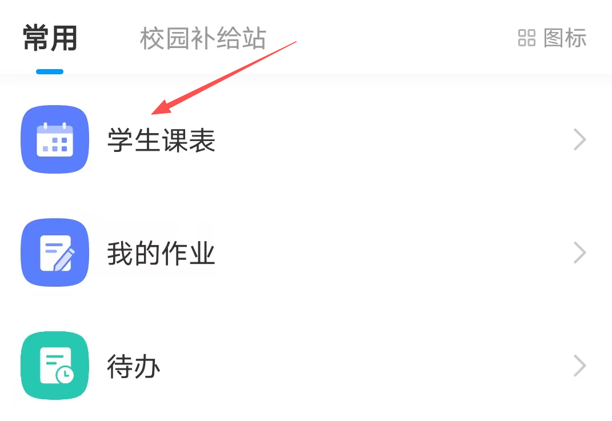
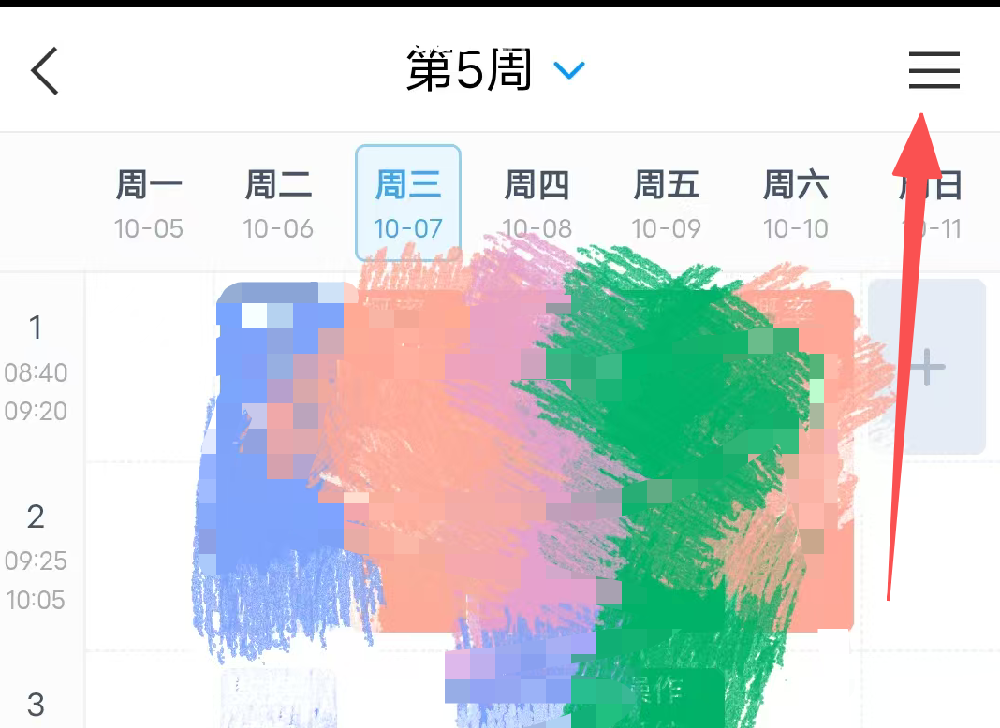
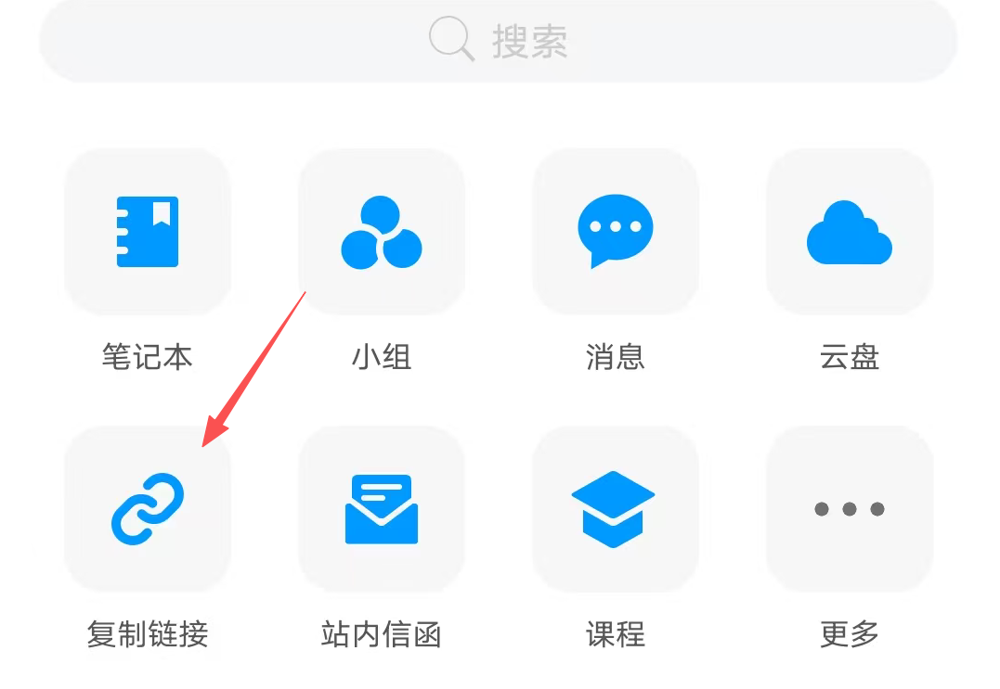

# 超星课表（Android App）

一个原生 Android 课表应用：粘贴超星课表链接后，自动抓取并展示你的每周课表。支持滑动切周、课程自定义颜色、改名、变更强调、每日自动刷新等，纯本地运行，无账号登录。

---

## 功能

- **抓取课表**：粘贴超星课表链接（含 `curriculumUuid`），抓取整学期每周课程并缓存。
- **周切换**：左右滑动切换周次，动画平滑；点顶部蓝色"本周：第 N 周"一键滑动回到真实本周。
- **每日自动刷新**：每天 08:00 自动刷新当前周（无需打开 App）。
- **课程自定义**：
  - 每门课可改显示名、位置（"全部同名课 / 仅这一节"两种生效范围）。
  - 每门课可自定义颜色（10 色池 + 随机不重复），默认按浅色池自动分配、互不相同。
- **变更强调**：课表与线上数据发生变化（换教室、调课等）时，橙色标记高亮；点课程弹窗可"取消本节/全部强调"。
- **显示设置**：课程/位置/表头字号、表头/格子高度、节次宽度、文字颜色（黑/白/灰）、上下课时间一行/两行、显示周六/周日等均可调，带实时预览与"恢复默认"。
- **动画速度**：切周/回弹/取消三段动画速度可调。
- **桌面小组件**：桌面直接显示当天/次日课程，带刷新按钮（联网重抓）、左右切换今天/明天，刷新时间与应用内同步；最小 2×2，可拉伸。
- **首次引导弹窗**：内置"获取课表链接（学习通）"图文步骤 + 可点击的项目主页链接。
- **矢量应用图标**：课表网格 + 彩色课程块，自适应圆形/圆角遮罩（Android 8+），兼容低版本。
- **持久化**：所有设置、自定义、课程数据、各周刷新时间均本地保存。

---

## 获取你的课表链接（教程）

首次使用前，先按下面三步复制你的超星课表链接：

**第 1 步**：打开应用，在「常用」（或应用中心）页点「学生课表」



**第 2 步**：进入课表页面后，点右上角的「≡」菜单



**第 3 步**：在弹出的菜单里点「复制链接」，把复制到的链接粘贴到本 App 的输入框即可



---

## 使用

1. 安装 APK（见"构建与安装"）。
2. 首次打开会弹出输入框：
   - 弹窗内含"获取课表链接（学习通）"图文步骤与可点击的项目主页链接。
   - 粘贴超星课表网页链接，例如：
     `https://kb.chaoxing.com/res/pc/curriculum/schedule.html?curriculumUuid=...`
   - 或直接粘贴其中的 `curriculumUuid`。
3. 保存后自动加载本周课表，之后即可左右滑动查看各周。

> 链接为空时每次启动会弹出填写框；链接输入框右侧 × 可清除，点保存才生效。

---

## 构建与安装

环境：Windows + JDK + Android SDK + Gradle 8.x（本工程用命令行 Gradle，无需 Android Studio）。

```bat
:: 构建 Debug APK（在工程根目录）
C:\Users\<你的>\.gradle\wrapper\dists\gradle-8.13-bin\<hash>\gradle-8.13\bin\gradle.bat -p "C:\path\to\ScheduleApp" assembleDebug --no-daemon

:: 产物
app\build\outputs\apk\debug\app-debug.apk
```

或用工程自带的 Gradle Wrapper：`gradlew.bat assembleDebug`（首次会自动下载 Gradle）。

安装到手机 / 模拟器：

```bat
:: 模拟器（MuMu 示例）
D:\MuMu\MuMuPlayer\nx_main\adb.exe connect 127.0.0.1:16384
D:\MuMu\MuMuPlayer\nx_main\adb.exe -s 127.0.0.1:16384 install -r app\build\outputs\apk\debug\app-debug.apk
```

---

## 技术栈与结构

- **语言**：Kotlin，纯 Android View（无 Compose）
- **接口**：`https://kb.chaoxing.com/curriculum/getOtherLessons`（需 UA + Referer 头）
- **数据存储**：SharedPreferences（文件名 `schedule`）

```
app/src/main/java/com/example/scheduleapp/
├── MainActivity.kt          # 主界面：课表展示、切周、弹窗编辑、刷新
├── SettingsActivity.kt      # 设置页：显示/动画/周六日等 + 课表预览
├── ScheduleView.kt          # 自绘课表 View：网格、课程、颜色、切周动画
├── ScheduleApi.kt           # 接口抓取与 JSON 解析
├── DailyRefreshReceiver.kt  # 每日 08:00 自动刷新
├── BootReceiver.kt          # 开机注册定时
├── ScheduleWidgetProvider.kt # 桌面小组件：当天课程 + 刷新/左右切换
└── ScheduleWidgetService.kt # 组件课程数据源（RemoteViewsService）
```

---

## 隐私说明

- **无账号、无云同步**：你的课表链接（`curriculumUuid`）、课表数据、所有设置只存在手机本地（SharedPreferences），不会上传到任何服务器。
- 源码与 git 历史中**不含**真实课表链接或个人身份信息；`DEFAULT_UUID` 为空，链接由你每次填写。
- 抓取使用超星公开课表接口，仅拉取你自己的课表数据。

---

## 提示：仅通过虚拟机和本人设备验证，如有不适配纯属正常！
